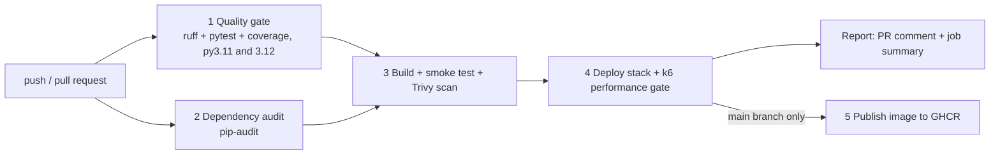

# CI/CD notes (Person B) - working notes, NOT the final text

Write Section 4.2 of the report and the guide sections yourself, in your own words.

## Pipeline diagram (Mermaid: GitHub renders it; redraw it cleanly for the report)

## Quality gates (a gate = if it fails, the pipeline stops)
| Gate | Tool | Threshold |
|---|---|---|
| Style and bugs | ruff | zero errors |
| Unit tests | pytest | all pass |
| Coverage | pytest-cov | at least 90% |
| Known vulnerabilities in packages | pip-audit | none |
| Known vulnerabilities in image | Trivy | no fixable CRITICAL |
| Performance | k6 thresholds | p95 < 500 ms, errors < 1% |

## Troubleshooting log (fill in with screenshots)
| # | Symptom | Cause | Fix |
|---|---|---|---|
| 1 | Warning "Node.js 20 is deprecated" | Actions used an old runtime | Upgraded checkout, setup-python, upload-artifact |
| 2 | Smoke test: "Invalid container name (t)" | Docker names need 2+ characters | Renamed the container to smoke-test |
| 3 | (your next incident) | | |

## Metrics this pipeline produces (for the experiments chapter)
- Image build duration (s), deployment duration (s), CI load test p95 (ms) and throughput (req/s).
- Each run's values are in the Summary tab and the report comment; raw files in the `ci-evidence` artifact.

## Design decisions to explain in the video
- The optimizer step is advisory: it posts recommendations, a human decides (no autonomous optimization).
- Deployment duration is measured with `docker compose up --wait`, which waits for health checks.
- The performance gate protects against regressions, not a full benchmark (that is C and D's experiments).
